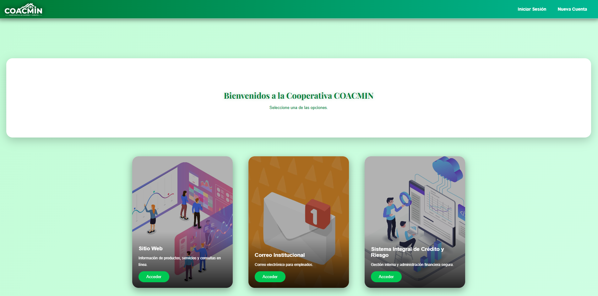
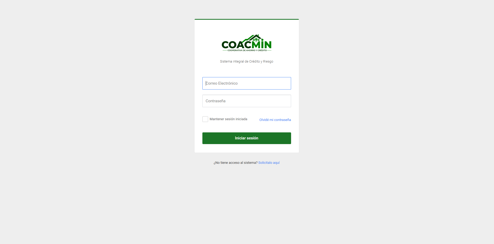
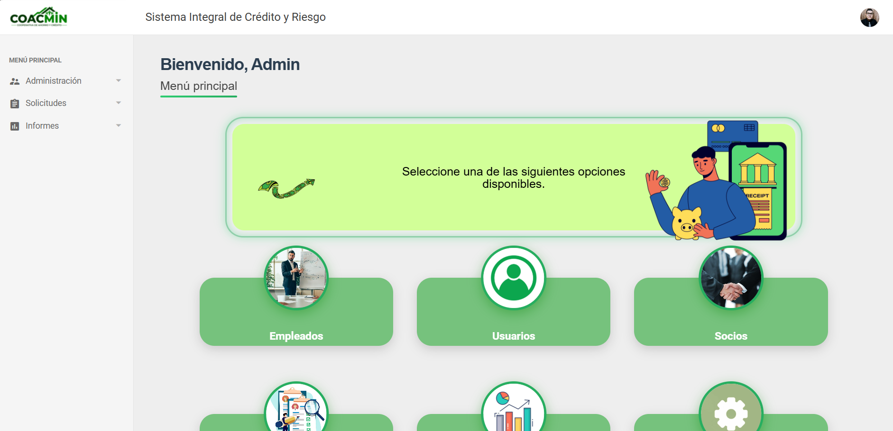
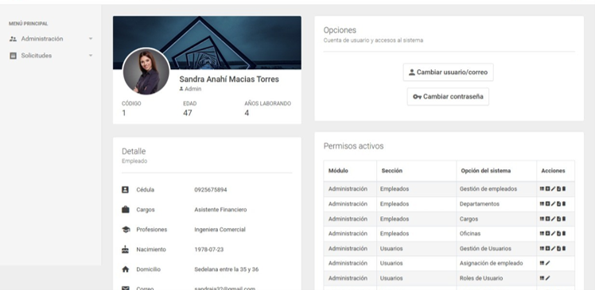
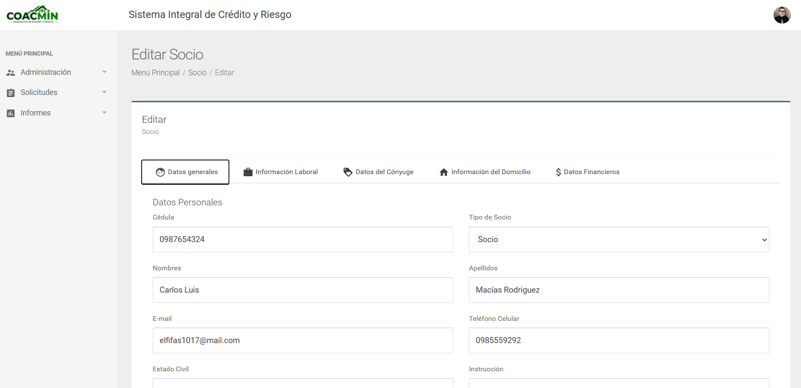
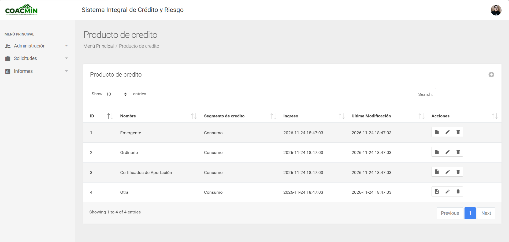
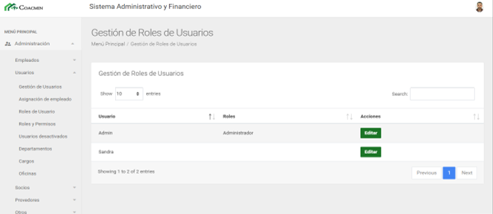
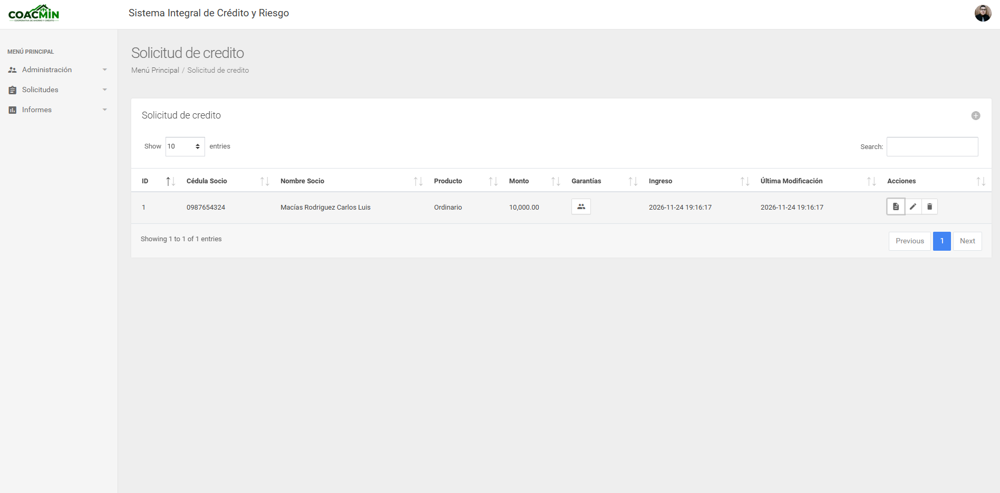
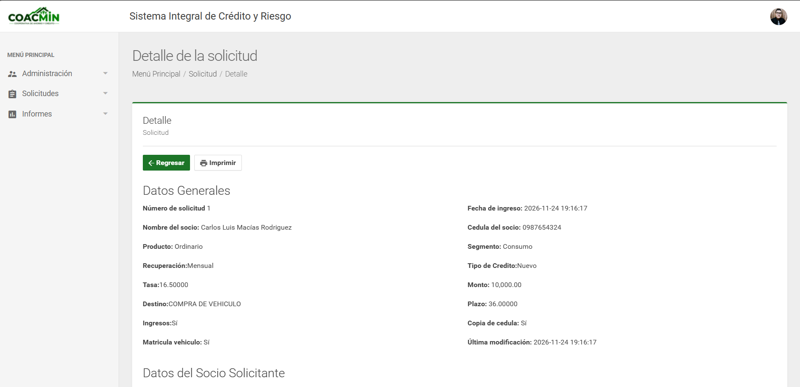
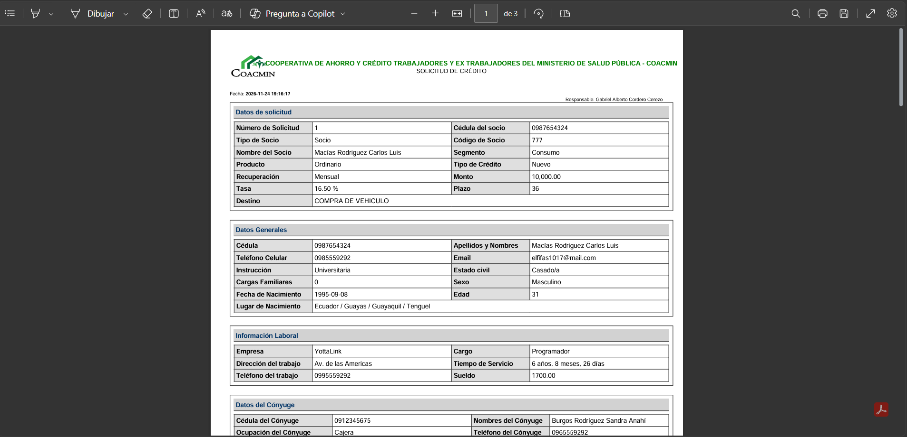

# Sistema de Gestión de Crédito para Cooperativas de Ahorro y Crédito

Aplicación web desarrollada para administrar información de socios y gestionar solicitudes de crédito dentro de una Cooperativa de Ahorro y Crédito. El sistema centraliza la información personal y laboral de los socios, permite configurar productos crediticios y facilita la generación de documentación asociada a las solicitudes.

## Descripción general

El sistema fue desarrollado con el propósito de digitalizar y organizar procesos administrativos relacionados con la gestión de socios y solicitudes de crédito, proporcionando una plataforma centralizada para el registro, consulta y administración de información.

Incluye módulos administrativos, gestión de usuarios y permisos, configuración de productos crediticios y herramientas para registrar solicitudes de crédito.

## Funcionalidades principales

### 1. Gestión de socios

- Registro y administración de información personal de los socios.
- Registro de información laboral.
- Administración de datos del cónyuge.
- Registro de información del domicilio.
- Ubicación geográfica del domicilio mediante un mapa interactivo.
- Consulta y actualización de información de los socios.

### 2. Gestión de solicitudes de crédito

- Registro de solicitudes de crédito.
- Administración de información relacionada con las solicitudes.
- Registro de datos necesarios para el proceso de evaluación crediticia.
- Generación de documentos PDF relacionados con las solicitudes.

### 3. Configuración de productos crediticios

Administración de los parámetros utilizados para estructurar la oferta crediticia de la cooperativa:

- Tipos de crédito.
- Segmentos de crédito.
- Productos de crédito.
- Configuración de tasas de interés.
- Parámetros relacionados con capital y plazos.
- Gestión de información para los procesos de recuperación.

### 4. Administración del sistema

- Gestión de empleados.
- Administración de cargos y profesiones.
- Gestión de departamentos y oficinas.
- Administración de usuarios.
- Asignación de empleados a usuarios.
- Gestión de roles y permisos.
- Administración de usuarios desactivados y restauración de registros.
- Configuración de cuenta y cambio de contraseña.

## Tecnologías utilizadas

| Tecnología | Aplicación |
|---|---|
| PHP / Laravel | Desarrollo del backend y lógica de negocio |
| Bootstrap | Diseño de interfaces y componentes visuales |
| PostgreSQL | Gestión de la base de datos relacional |
| JavaScript | Interactividad del lado del cliente |
| OpenStreetMap | Visualización de mapas y ubicación geográfica |
| PDF | Generación de documentos |

## Responsabilidades de desarrollo

Desarrollo individual del sistema, incluyendo:

- Análisis y desarrollo de funcionalidades.
- Diseño e implementación de formularios y módulos administrativos.
- Desarrollo de operaciones CRUD.
- Modelado y gestión de información en una base de datos relacional.
- Implementación de gestión de usuarios, roles y permisos.
- Integración de mapas interactivos.
- Generación de documentos PDF.
- Desarrollo y mantenimiento de funcionalidades del sistema.

## Estado del proyecto

| Módulo | Estado |
|---|---|
| Gestión de empleados y usuarios | Implementado |
| Roles y permisos | Implementado |
| Gestión de socios | Implementado |
| Configuración de tipos y segmentos de crédito | Implementado |
| Configuración de productos crediticios | Implementado |
| Registro de solicitudes de crédito | Implementado |
| Generación de documentos PDF | Implementado |
| Evaluación y análisis crediticio | En desarrollo |

## Capturas de pantalla

Las siguientes imágenes corresponden a interfaces del sistema y se incorporarán con información anonimizada.

### Bienvenida

### Login

### Menú Principal

### Cuenta de usuario

### Gestión de socios

### Configuración de productos crediticios

### Gestión de usuarios y permisos

### Solicitudes de crédito

### Detalle Solicitud de crédito

### Generación de documentos

## Consideraciones

Este repositorio tiene fines demostrativos y documentales. El código fuente original no se encuentra publicado en un repositorio público, debido a que corresponde a un proyecto de carácter comercial.

En las capturas incluidas se utilizó exclusivamente información ficticia o debidamente anonimizada.

---

**Desarrollo:** Individual  
**Tipo de aplicación:** Sistema web administrativo y financiero  
**Backend:** Laravel  
**Base de datos:** PostgreSQL